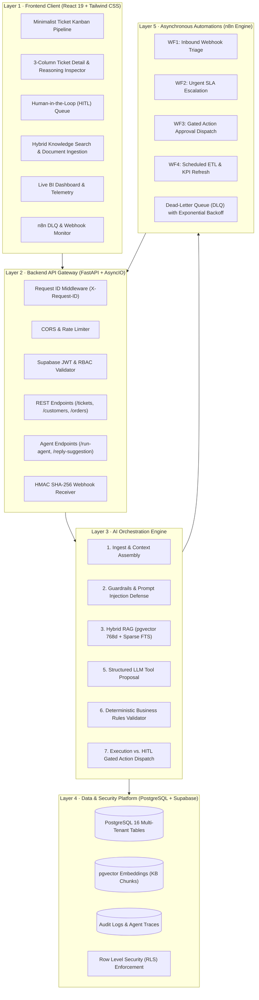

# Custome-X (CXPilot) — Comprehensive System Architecture & Features

> **Autonomous Agentic AI Customer Support & Operations Platform for E-Commerce**  
> *Core Architectural Axiom: "The LLM Proposes, Deterministic Code Decides."*  
> *Generated with Codebase Knowledge Graph Analysis (`graphify`).*

---

## 1. Executive Summary & Core Mission

**Custome-X** is an enterprise-grade, agentic AI customer support and commerce operations platform built to solve the fundamental failure modes of naive LLM wrappers:
* Hallucinated business facts, pricing, and order states
* Unauthorized database state mutations
* Security prompt injections and system jailbreaks
* Opaque, non-auditable decision making

Custome-X pairs an **autonomous 7-step orchestration engine** with a **deterministic business rules validator**, **Human-in-the-Loop (HITL) approval gateways**, **hybrid dense/sparse vector search (pgvector + FTS)**, and a modern **Twenty CRM-inspired Swiss minimal interface**.

---

## 2. Complete Technology Stack

| Layer | Technologies & Frameworks | Purpose & Responsibility |
| :--- | :--- | :--- |
| **Frontend Framework** | **React 19**, **TypeScript 5.8**, **Vite 8** | Single Page Application (SPA), lightning-fast HMR and bundle optimization |
| **UI & Styling** | **Tailwind CSS v4**, Lucide React, Space Grotesk & DM Sans | Twenty CRM-inspired airy, minimalist Swiss aesthetics with 20 semantic CSS design tokens |
| **Data Visualization** | **Recharts 3.10** | Inbound volume area charts, deflection rates, CSAT metrics, and latency distribution |
| **Routing & State** | **React Router v7**, React Context API (`AuthContext`) | Client-side routing, route guards, token persistence, and tenant auto-resolution |
| **Backend API Gateway** | **FastAPI 0.115+**, **Python 3.14 (AsyncIO)** | High-throughput asynchronous REST API gateway and WebSocket streaming server |
| **Server Engine** | **Uvicorn 0.54** | Asynchronous Server Gateway Interface (ASGI) runtime with hot reload |
| **Database & ORM** | **PostgreSQL 16**, **SQLAlchemy 2.0 (asyncpg)**, **Alembic** | Multi-tenant relational schema, strict foreign keys, async connection pooling, migrations |
| **Vector Search (RAG)** | **pgvector (768-dim)** + **PostgreSQL FTS** | Hybrid Reciprocal Rank Fusion (RRF) search combining semantic cosine similarity and lexical search |
| **AI & LLM Engine** | **Google Gemini API**, Google GenAI SDK | Intent recognition, entity extraction, semantic reasoning, and structured tool proposals |
| **Security & Auth** | **Supabase Auth & RLS**, PyJWT, passlib/bcrypt, HMAC-SHA256 | Multi-tenant row-level security, webhook verification, token-bucket rate limiting |
| **Workflow Engine** | **n8n Master Automations** | Asynchronous webhook routing (Shopify/WooCommerce), Slack/email alerts, DLQ handling |
| **Knowledge Graph** | **Graphify (NetworkX, tree-sitter, AST)** | Codebase symbol topology, dependency clustering, god-node detection, and static analysis |

---

## 3. Codebase Knowledge Graph Insights (`graphify`)

Analysis generated by `graphify` over the 192 project files (1,261 nodes, 3,772 edges, 63 communities):

```
Graph: 1261 nodes · 3772 edges · 63 functional communities
Extraction Integrity: 90% EXTRACTED · 10% INFERRED · 0% AMBIGUOUS (avg confidence: 0.94)
Interactive Visualization: graphify-out/graph.html
Detailed Report: graphify-out/GRAPH_REPORT.md
```

### Top 10 God Nodes (Core Architectural Abstractions)
These nodes represent the most interconnected centers of gravity in the codebase:

1. **`User` (98 edges)** — The fundamental actor entity linking auth, tenancy, supervisor roles, and audit trails.
2. **`Organization` (87 edges)** — The multi-tenant root partition isolating database rows, API keys, and configurations.
3. **`Customer` (59 edges)** — The e-commerce customer profile tracking lifetime value, orders, and sentiment history.
4. **`Ticket` (49 edges)** — The core unit of work with state machine transitions (`open`, `in_progress`, `escalated`, `closed`).
5. **`create_ticket_atomic()` (35 edges)** — Transaction-safe atomic intake handler provisioning customers, sequential IDs, and initial agent routing.
6. **`Base` (32 edges)** — SQLAlchemy declarative model base standardizing UUIDs and timestamp mixins across all tables.
7. **`get_current_user()` (27 edges)** — Security dependency enforcing Supabase JWT verification and RBAC permissions.
8. **`react` (27 edges)** — Primary UI component tree anchor binding views, layouts, and modals.
9. **`OrchestrationEngine` (26 edges)** — The central 7-step autonomous agent reasoning and tool execution engine.
10. **`AuthService` (26 edges)** — Multi-strategy authentication service with resilient fallback and automatic tenant resolution.

---

## 4. End-to-End Architectural Layers



---

## 5. Detailed Feature Breakdown

### 5.1 Layer 1: Frontend Client & Dashboard Experience
* **Minimalist Ticket Kanban Pipeline (`TicketsPage.tsx`)**:
  * 4 visual support lifecycle stages: *Open (◌)*, *In Progress (🔵)*, *Escalated (🟡)*, and *Resolved (🟣)*.
  * Drag-and-drop support ticket cards with live stage recalculation and column financial totals.
  * Instant switching between Kanban Board and dense tabular CRM views.
* **3-Column Ticket Inspector (`TicketDetailPage.tsx` + `OrchestratorInspector.tsx`)**:
  * Left pane: Conversation thread and message history.
  * Center pane: Live chat composer with AI suggestion generation and real-time step-by-step reasoning inspector.
  * Right pane: Customer contextual profile, lifetime spending, recent order tracking, and sentiment trends.
* **Human-in-the-Loop (HITL) Queue (`ApprovalsPage.tsx`)**:
  * High-risk proposals (refunds > $50, order cancellations, address updates) are blocked from execution until human staff approval.
  * Diff viewer displaying proposed state mutation vs. current database state, with staff approval rationale stamps.
* **RAG Knowledge Base Explorer (`KnowledgePage.tsx`)**:
  * Document upload and chunking interface.
  * Live Reciprocal Rank Fusion (RRF) test search with simultaneous dense vector score (pgvector 768d) and sparse PostgreSQL full-text search (tsvector/tsquery) score visualization.
* **Operational Analytics & Telemetry (`AnalyticsPage.tsx`)**:
  * Segmented time-range controls (7D, 30D, 90D).
  * KPI cards: Inbound Volume, Autonomous Deflection Rate (target >65%), First Response Time (FRT), and CSAT.
  * Area charts and categorization distribution graphs powered by Recharts.
* **Automations & Webhook Monitor (`AutomationsPage.tsx`)**:
  * Real-time dispatch telemetry, HMAC signature verification badges, idempotency key copier.
  * Dead-Letter Queue (DLQ) inspection modal with JSON payload viewer and 1-click re-delivery.

### 5.2 Layer 2: Backend API Gateway
* **Atomic Sequential Ticket Intake (`POST /api/v1/tickets`)**:
  * Generates sequential human-readable numbers (`TICK-0001`, `TICK-0002`).
  * Auto-provisions customer records if the customer does not yet exist.
* **Agent Execution Endpoints (`POST /api/v1/agent/run-agent`)**:
  * Streams intermediate agent execution steps via WebSockets or returns structured response payload.
* **HMAC-SHA256 Webhook Gateway (`POST /api/v1/automations/webhook`)**:
  * Verifies `X-Signature-SHA256` using constant-time comparison to prevent timing attacks.
  * Deduplicates events via unique `idempotency_key` stored in database.

### 5.3 Layer 3: AI Orchestration Engine (`engine.py`)
Custome-X implements a strictly verified **7-Step Deterministic Pipeline**:
1. **Input Validation & Sanitization:** Enforces length caps (`MAX_MESSAGE_LENGTH = 2000`), masks PII (credit cards, SSNs) in traces, neutralizes XML-like delimiter breakout tags, and executes dual-scope prompt injection defense (`DIRECT_INJECTION_PATTERNS` on live messages; `looks_like_instruction()` on stored KB/notes/tools).
   * **What a flag does:** Step 1 logs a warning, caps confidence at 0.50, and forces `needs_human = True` (blocking autonomous actions and routing to HITL queue).
   * **Empirical Benchmark (`test_prompt_injection_benchmarks.py`):** 0.0% False Positive Rate across 30 normal customer messages; 100.0% Block Rate across 20 adversarial injection attacks.
2. **Intent Classification & Entity Extraction:** Canonical deterministic regex and token extractors parse order identifiers (`ORD-\d+`), SKUs, and dollar amounts before calling the LLM.
3. **RAG Hybrid Retrieval:** Queries PostgreSQL `public.match_knowledge_chunks` combining 768-dim dense vectors with sparse `tsvector` FTS via Reciprocal Rank Fusion, scoped to tenant and active status.
4. **Business Data Needs Planning:** Deterministic planner identifies prerequisite server tools; if an order ID is present, automatically schedules `get_order_details`.
5. **Server-Side Tool Execution & Ownership Validation:** Executes typed Python tools in `ToolRegistry` with strict schema validation. Asserts customer ownership of records; raises `OwnershipViolationError` (HTTP 403) on cross-customer tampering.
6. **Business Rule Engine & Financial Threshold Guards:** Applies business constraints: 30-day return policy window, $50.00 autonomous refund limit (`REFUND_AUTONOMOUS_THRESHOLD_CENTS = 5000`), block on in-transit cancellations, and outbound URL host allow-listing (`strip_unknown_urls`). High-risk actions set `requires_approval = True`.
7. **Structured Action Proposal Output:** Grounded response synthesis via Google Gemini API (`GEMINI_MODEL`, fallback `GEMINI_FALLBACK_MODEL`) with deterministic offline fallback, accompanied by full immutable step audit traces in `OrchestrationResponse`.

* **Hybrid RAG Pipeline (`retrieval.py` & `knowledge_service.py`)**:
  * **Primary SQL RRF Path (`public.match_knowledge_chunks`)**: Executes PostgreSQL stored procedure combining dense vector cosine similarity (768-dim `text-embedding-004` via `pgvector`) and sparse full-text search (`tsvector` generated column against `plainto_tsquery('english', query)`) using Reciprocal Rank Fusion:
    $$RRF\_Score(d) = \frac{1}{60 + rank_{dense}(d)} + \frac{1}{60 + rank_{sparse}(d)}$$
    strictly scoped by tenant (`organization_id = auth_org_id`) and active status (`status = 'active'`).
  * **Resilient Keyword Fallback Path (`search_knowledge`)**: In offline environments or development testing without database access, performs in-memory weighted keyword overlap scoring ($hits / |query\_tokens|$) across sample policy chunks. All legacy references to external Lucene/BM25 engines have been eliminated in favor of native PostgreSQL FTS.
* **Deterministic Business Rules Validator (`rules.py`)**:
  * Validates every tool call proposal against concrete constraints.
  * Example: If `issue_refund` amount exceeds $50.00, status is automatically set to `requires_approval`, halting execution until staff review.

### 5.4 Layer 4 & 5: Data & Integration
* **Multi-Tenant Isolation Architecture & Verified RLS Policies**:
  * Multi-tenancy is enforced through **Application-Level Tenant Isolation** using strict `organization_id` query filters on all database access paths, backed by foreign-key relational schemas.
  * Verified in `tests/test_tenant_a_cannot_read_tenant_b_tickets.py`: Tenant A attempting to read Tenant B's tickets gets nothing (0 items on list queries, HTTP 404 `TicketNotFoundError` on direct ID lookups).
  * **Actual Database Row-Level Security (RLS) Implementation (Migrations `bad184373bcd` & `675875ef33d9`)**:
    PostgreSQL RLS policies invoke a `SECURITY DEFINER` function `public.get_auth_organization_id() RETURNS uuid` (`SELECT organization_id FROM public.users WHERE id = auth.uid() LIMIT 1`) to eliminate policy recursion while guaranteeing engine-level isolation:
    * `public.users`: `(id = auth.uid() OR organization_id = public.get_auth_organization_id())`
    * `public.organizations`: `(id = public.get_auth_organization_id())`
    * `public.customers` & `public.tickets`: `(organization_id = public.get_auth_organization_id())`
    * `public.messages` & `public.ticket_events`: `(ticket_id IN (SELECT id FROM public.tickets WHERE organization_id = public.get_auth_organization_id()))`
    * `public.knowledge_documents` & `public.knowledge_chunks`: `(organization_id = public.get_auth_organization_id())`
* **n8n Master Workflows**:
  * `WF1`: New ticket ingestion & initial classification notification.
  * `WF2`: Urgent ticket escalation to supervisor Slack channel.
  * `WF3`: HITL gated action dispatch with direct review link.
  * `WF4`: Scheduled hourly ETL and KPI data lake sync.

---

## 6. How to Run & Verify the Platform

### Start the Backend Service
```bash
cd backend
.\.venv\Scripts\python.exe -m uvicorn main:app --host 127.0.0.1 --port 8000 --reload
```
* API Base: [http://127.0.0.1:8000](http://127.0.0.1:8000)
* Interactive Swagger Docs: [http://127.0.0.1:8000/docs](http://127.0.0.1:8000/docs)

### Start the Frontend Service
```bash
cd frontend
npm run dev
```
* Dashboard URL: [http://127.0.0.1:5173](http://127.0.0.1:5173)

### Run Automated Test Suites
```bash
# Backend pytest suite (unit, RAG, orchestrator, approval tests)
cd backend
.\.venv\Scripts\pytest.exe -v

# Frontend TypeScript compilation & production build
cd frontend
npm run build
```
